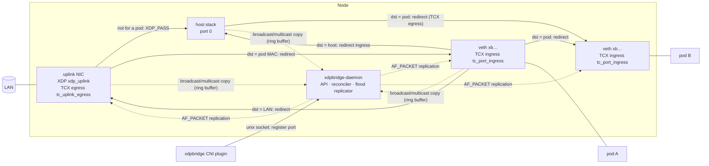

# xdpbridge

**An XDP L2 switch and CNI plugin that puts Kubernetes pods directly on the
LAN without macvlan.**

xdpbridge attaches pods to the LAN segment behind a node's physical NIC. One NIC
fans out to many pods through a small switch built from BPF programs: XDP on
the NIC, TCX on per-pod veths, and a userspace helper for broadcast and
multicast. It works as a [Multus](https://github.com/k8snetworkplumbingwg/multus-cni)
delegate plugin and runs alongside Cilium.

> Status: **v0.1 proof of concept.** The data path, the daemon and the CNI
> plugin pass an end-to-end network-namespace integration test in native and
> generic XDP mode ([TESTLOG.md](TESTLOG.md)). It has not yet run on real
> cluster nodes. Interfaces may change before v1.0.

## Why not macvlan?

| Problem with macvlan | xdpbridge |
|---|---|
| The host and same-node pods cannot reach a macvlan child (the parent cannot talk to its own children). Workarounds need a host-side macvlan shim, which is awkward on immutable OSes. | The host stack is a switch port. Host↔pod and pod↔pod traffic on the same node is switched locally. |
| Per-pod child interfaces on the NIC; hairpin and unicast quirks that differ per driver and bridge/VLAN topology. | Pods attach through plain veth pairs. The NIC only runs one XDP program and is put in promiscuous mode. |
| When the meta-plugin wedges, pods start "Running" with the secondary interface silently missing. | CNI ADD fails unless the node daemon has registered the port. A reconciler and watchdog flag drift loudly (`/healthz`, metrics, error logs). |
| NADs name the parent interface, so they sprawl per node when NIC names differ. | The uplink is a per-node daemon setting (name, candidate list, or `default-route`). One NAD serves the whole cluster. |

## Architecture



* **Unicast** is switched entirely in BPF by destination MAC (+ VLAN):
  * wire → pod: XDP redirect,
  * pod → pod / host / wire: TCX redirect on the pod's host veth,
  * host → pod: TCX egress redirect on the uplink.
* **Broadcast/multicast** (ARP, ND, mDNS, SSDP, …) is copied to a BPF ring
  buffer, and the daemon replicates it to the other ports over AF_PACKET.
  The host stack always gets its copy from the kernel.
* **Everything else** is untouched. Frames that are not for a pod get
  `XDP_PASS`, and the egress program returns `TCX_NEXT`. Cilium (or anything
  else on TC) sees the same traffic as before.
* Per-port **anti-spoofing** (a pod may only send from its own MAC) and
  **VLAN access ports** (`"vlan": N` tags on the uplink and strips toward
  the pod).

The full data path, map layout, flood design and failure modes are in
[docs/design.md](docs/design.md).

## Requirements

* Linux ≥ 6.6 (TCX). Tested on x86_64 with kernel 6.18; arm64 should work (the BPF object is little-endian generic) but is untested.
* A NIC with native XDP (e.g. `i40e`, `ice`, `mlx5`, `atlantic`) for full
  speed. Any NIC works in generic (SKB) mode, for example `r8169` or
  `e1000e`; the daemon falls back automatically.
* The uplink XDP hook must be free. xdpbridge refuses to replace another XDP
  program unless started with `--force-xdp`.
* Multus (thin or thick) for Kubernetes integration. An IPAM plugin
  (`host-local`, `static`, `whereabouts`, …) must be present in
  `/opt/cni/bin`.
* bpffs mounted at `/sys/fs/bpf` on the node (standard with Cilium).
* Pod network namespaces under `/run/netns` (or `/var/run/netns` with
  `/var/run` a symlink to `/run`, as on Talos). The DaemonSet mounts it so
  the reconciler can see them; adjust the `netns` hostPath otherwise.
* With Multus thick, keep its default `chrootDir`. The plugin then runs
  against the host root and reaches the daemon socket at `/run/xdpbridge`.
  Verified on Talos, which ships `host-local` and the other reference
  plugins in `/opt/cni/bin`.

## Install

1. Build and push the image (or use a published one), then set the image in
   `deploy/daemonset.yaml`:

   ```sh
   make image IMAGE=registry.example/xdpbridge:v0.1.0
   docker push registry.example/xdpbridge:v0.1.0
   ```

2. Pick the uplink in the `xdpbridge-config` ConfigMap (`XDPBRIDGE_UPLINK`). It can
   be an interface name, a comma-separated candidate list where the first
   existing interface wins (`enp1s0f0,eno1`), or `default-route`.

3. Label the nodes that should run xdpbridge, then apply the manifests:

   ```sh
   kubectl label node <node> xdpbridge/enabled=true
   kubectl apply -k deploy/
   kubectl -n xdpbridge-system get pods -o wide
   ```

   The init container installs the plugin as `/opt/cni/bin/xdpbridge`. The
   daemon pod becomes Ready once XDP is attached and `/healthz` is OK.

4. Create a NetworkAttachmentDefinition and attach pods to it (below).

Check a node:

```sh
kubectl -n xdpbridge-system exec ds/xdpbridge -- /usr/local/bin/xdpbridge-daemon status
kubectl -n xdpbridge-system exec ds/xdpbridge -- /usr/local/bin/xdpbridge-daemon ports
```

### Multus NetworkAttachmentDefinition example

This example uses static IPAM, so each pod picks its address and,
optionally, its MAC:

```yaml
apiVersion: k8s.cni.cncf.io/v1
kind: NetworkAttachmentDefinition
metadata:
  name: lan-static
spec:
  config: |
    {
      "cniVersion": "1.0.0",
      "name": "lan-static",
      "plugins": [{
        "type": "xdpbridge",
        "capabilities": { "ips": true, "mac": true },
        "ipam": { "type": "static" }
      }]
    }
---
apiVersion: v1
kind: Pod
metadata:
  name: lan-demo
  annotations:
    k8s.v1.cni.cncf.io/networks: |
      [{ "name": "lan-static", "interface": "net1",
         "ips": ["192.0.2.50/24"], "mac": "02:00:00:00:00:50" }]
spec:
  nodeSelector: { xdpbridge/enabled: "true" }
  containers:
    - { name: demo, image: busybox:1.36, command: ["sleep", "infinity"] }
```

More examples are in [`deploy/examples/`](deploy/examples): host-local IPAM
and a VLAN access port. `host-local` allocates per node, so give each node a
disjoint range or use a cluster-wide IPAM.

### CNI configuration reference

| Key | Default | Meaning |
|---|---|---|
| `type` | — | `xdpbridge` |
| `ipam` | none | Delegated IPAM plugin config. Without it the interface is brought up with no address (e.g. for DHCP inside the pod). |
| `vlan` | `0` | Access VLAN (1–4094). Frames are tagged on the uplink and untagged toward the pod. |
| `mtu` | kernel default | MTU of the veth pair |
| `mac` / `runtimeConfig.mac` / `args.cni.mac` / `CNI_ARGS MAC=` | random locally administered | Pod MAC. The `mac` capability takes precedence. |
| `socket` | `/run/xdpbridge/xdpbridge.sock` | Daemon socket |
| `timeoutSeconds` | `10` | Daemon request timeout |

### Daemon flags

Every flag can also be set through an environment variable:

| Flag | Env | Default |
|---|---|---|
| `--uplink` | `XDPBRIDGE_UPLINK` | (required) name, list, or `default-route` |
| `--xdp-mode` | `XDPBRIDGE_XDP_MODE` | `auto` (native, then generic) |
| `--force-xdp` | `XDPBRIDGE_FORCE_XDP` | `false` |
| `--bpffs` | `XDPBRIDGE_BPFFS` | `/sys/fs/bpf/xdpbridge` |
| `--socket` | `XDPBRIDGE_SOCKET` | `/run/xdpbridge/xdpbridge.sock` |
| `--state-file` | `XDPBRIDGE_STATE_FILE` | `/var/lib/xdpbridge/state.json` |
| `--probe-addr` | `XDPBRIDGE_PROBE_ADDR` | `127.0.0.1:9967` (`/healthz`, `/livez`, `/metrics`) |
| `--reconcile-interval` | — | `10s` |
| `--log-level`, `--log-format` | `XDPBRIDGE_LOG_LEVEL`, `XDPBRIDGE_LOG_FORMAT` | `info`, `json` |

### Kubernetes-API watchdog (optional)

`kubectl apply -k deploy/k8s-watch/` instead of `deploy/` enables a
cross-check of registered ports against the pods on each node. A running
pod whose xdpbridge attachment has no port, or a port without its pod, then
fails `/healthz` and shows up in `xdpbridge_k8s_missing_ports` /
`xdpbridge_k8s_orphan_ports`. The overlay adds read-only RBAC for pods and NADs
and mounts the ServiceAccount token. The base deployment mounts no token.

### Validating a node

`hack/validate-node.sh` prints a PASS/FAIL summary. It checks that the XDP
program is attached, Cilium's TCX programs are still on the uplink, the
daemon is healthy, and the pins are present:

```sh
# on the node (privileged hostNetwork pod with ip/bpftool):
XDPBRIDGE_UPLINK=eth1 hack/validate-node.sh
# from a workstation, through the node's daemon pod:
KUBECTL="kubectl --context my-cluster" XDPBRIDGE_NODE=<node> hack/validate-node.sh
```

Set `XDPBRIDGE_EXPECT_TCX=""` on clusters without Cilium. The header of the
script lists all settings.

### Uninstall

Stopping or deleting the daemon **does not** remove the data path. Pinned
links keep forwarding, so that restarts are hitless. To remove xdpbridge from a
node, delete the DaemonSet (or unlabel the node), then run on the node:

```sh
xdpbridge-daemon teardown        # --bpffs/--state-file if not default
```

It detaches every pinned XDP/TCX link, removes the pins under
`/sys/fs/bpf/xdpbridge`, restores the uplink's promiscuous mode and VLAN
offloads, verifies that no XDP program remains, and refuses to run while a
daemon is still serving.

## Coexistence with Cilium

xdpbridge was designed next to Cilium in tunnel mode with kube-proxy
replacement and `bpf-lb-acceleration: disabled`, the default, which leaves
the NIC's XDP hook empty.

* xdpbridge owns the uplink **XDP** slot. Frames that are not for an xdpbridge pod
  get `XDP_PASS` and reach Cilium's TCX ingress program unchanged. Do not
  enable Cilium's XDP acceleration on the same NIC. The daemon refuses to
  start if it finds a foreign XDP program.
* xdpbridge adds one program at the head of the uplink's **TCX egress** chain.
  It only redirects host→xdpbridge-pod frames and returns `TCX_NEXT` for
  everything else.
* xdpbridge pod veths are not Cilium endpoints. Traffic between xdpbridge pods and
  the LAN or host bypasses Cilium network policy and the host firewall,
  just as with macvlan. Use pod-level firewalls if you need filtering on
  the secondary network.

## Limitations (v0.1)

* **No multi-program XDP.** xdpbridge needs the uplink XDP hook to itself
  (libxdp dispatcher support is future work).
* **Multicast is flooded** to every port on the VLAN (no IGMP/MLD snooping).
  Receivers filter by group membership. Fine for mDNS/SSDP volumes, not for
  multicast video.
* **Flood path in userspace.** If the daemon is down, unicast keeps working
  on the pinned data path, but new ARP/ND resolutions fail until it is back.
  Flood frames larger than 2048 bytes are not replicated.
* **VLAN**: access ports only (one VLAN per attachment). The host takes
  part on the untagged segment and on every 802.1Q subinterface of the
  uplink (`<uplink>.<vid>`), discovered automatically. The NIC's VLAN RX
  offload is turned off. If the driver cannot turn it off, tagged traffic
  for VLAN ports is not switched (warning logged).
* A port cannot reach a **macvlan** endpoint on the same node (the
  physical switch does not hairpin). Migrating that workload to xdpbridge
  resolves it. See docs/design.md.
* **IPv6**: ND/MLD work through the flood path, and link-local ping is
  tested. There is no ND proxying or MLD snooping, and IPv6 coverage is
  thinner than IPv4.
* Bonds, VLAN sub-interfaces and bridges as uplinks are untested.
* Performance has only been sanity-checked on veths (see TESTLOG.md). Those
  numbers say nothing about real NICs.

## Development

Toolchain: Go (version in `go.mod`), clang/LLVM, libbpf headers
(`libbpf-dev`), iproute2. The integration test also needs tcpdump, iperf3,
ethtool and python3.

```sh
make generate      # compile bpf/xdpbridge.bpf.c and generate Go bindings (bpf2go)
make build         # bin/xdpbridge-daemon, bin/xdpbridge-cni, bin/host-local (test IPAM)
make test          # go vet, gofmt check, unit tests (-race)
sudo make integration   # netns integration test, native + generic XDP; rewrites TESTLOG.md
hack/check-hygiene.sh   # SPDX headers, no non-documentation addresses
```

The integration test (`test/netns_test.sh`) builds a self-contained
topology from network namespaces:

```
ext (LAN host, 192.0.2.100; VLAN 100: 198.51.100.100)
 └─ ext0 ═══ uplink0  (stands in for the physical NIC)
             node ns: 192.0.2.1, xdpbridge-daemon, CNI plugin
              ├─ xb… ═══ eth1  pod1 ┐
              ├─ xb… ═══ eth1  pod2 ├ untagged, host-local 192.0.2.10-19
              ├─ xb… ═══ eth1  pod3 ┘
              └─ xb… ═══ eth1  pod4   VLAN 100
```

The test checks pod↔LAN, pod↔pod, pod↔host, ARP in every direction,
broadcast to all ports, mDNS/SSDP multicast (joined vs. not-joined
receivers), XDP_PASS of non-switched traffic, VLAN tagging and isolation,
IPv6 ND, anti-spoofing, daemon restart, CNI failure behaviour, the watchdog,
refusal to take over a foreign XDP program, garbage collection and CNI DEL.
It never touches interfaces outside its own namespaces.
`./test/netns_test.sh --mode native --keep` keeps the work directory for
debugging.

Repository layout:

```
bpf/                 BPF C sources (dual GPL-2.0/BSD-2-Clause)
cmd/xdpbridge-daemon/    node daemon
cmd/xdpbridge-cni/       CNI plugin
internal/bpfobj/     bpf2go bindings (generated, not committed)
internal/datapath/   load/attach/pin, map access
internal/flood/      flood replication (ring buffer → AF_PACKET)
internal/daemon/     registry, API, reconciler, metrics
internal/cniconfig/  CNI config parsing
internal/api/        API types and client
deploy/              Kubernetes manifests and examples
test/                netns integration test
docs/design.md       design document
```

See [CONTRIBUTING.md](CONTRIBUTING.md) before sending changes.

## Versioning and license

xdpbridge follows [Semantic Versioning](https://semver.org/). Until 1.0.0 the
daemon API, CNI configuration and pinned map layout may change in minor
releases; each change will be called out in release notes. After an
upgrade that changes the map layout, run `xdpbridge-daemon teardown` before
restarting.

Userspace code is licensed under the [Apache License 2.0](LICENSE). The BPF
programs in `bpf/` are dual-licensed `GPL-2.0-only OR BSD-2-Clause`, as
required for GPL-only kernel helpers.
