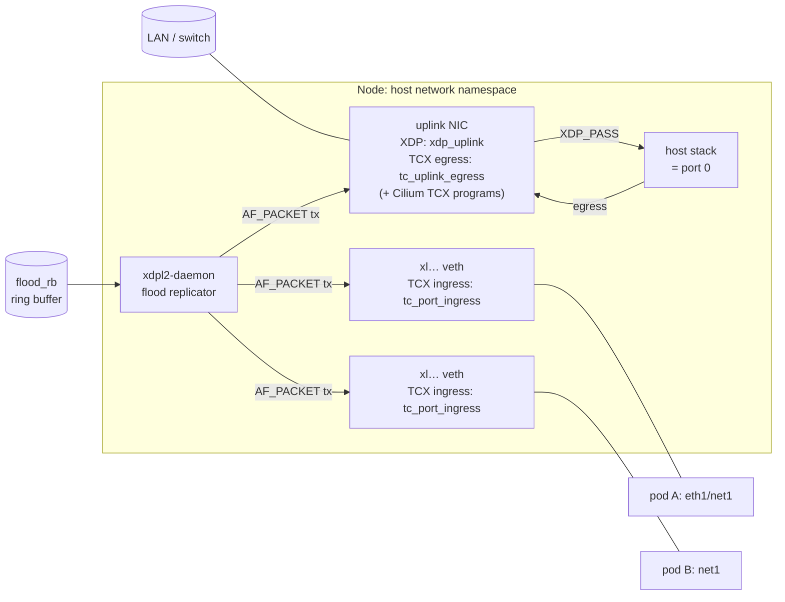

# xdpl2 design

This document describes the phase-1 implementation: the data path, the flood
path, the maps, the control plane, and how failures are handled. Where the
implementation departs from the original design sketch, the reason is given
under [Deviations](#deviations).

## 1. Goals and non-goals

xdpl2 attaches pods to the LAN segment of a node's physical NIC (the
*uplink*). It is a small software L2 switch built from BPF programs. It
replaces macvlan for secondary pod networks, and fixes three macvlan problems:

* the host and same-node pods can reach xdpl2 pods (the host stack is a switch
  port),
* there are no per-pod child interfaces on the uplink, and no driver-specific
  hairpin behaviour,
* a pod never starts with its secondary interface silently missing (CNI ADD
  fails if the port cannot be registered, and a watchdog flags drift).

Non-goals for phase 1: replacing Multus, SR-IOV/DPUs, IGMP/MLD snooping,
libxdp multi-program chaining, and performance work beyond a sanity number.

## 2. Topology

Every pod attachment is a veth pair. The pod end lives in the pod. The host
end (named `xl` + 11 hex chars of a hash of container id + interface name)
is a switch *port*. The host network stack is port 0, which is reached
through the uplink device itself.

## 3. Data path

There are three programs, all in `bpf/xdpl2.bpf.c`.

### 3.1 `xdp_uplink`: XDP on the uplink (frames from the wire)

1. Parse Ethernet and an optional outer 802.1Q/802.1ad tag (the VLAN id).
2. **Broadcast/multicast destination**:
   * If the *source* MAC is a local port on that VLAN, the frame is one of
     ours coming back (in generic mode the program also sees frames we
     inject with `BPF_F_INGRESS`, and a LAN loop could reflect our own
     frames). It gets `XDP_PASS` and is not replicated again.
   * Otherwise the frame is copied into the `flood_rb` ring buffer (origin
     `UPLINK`, VLAN, tagged flag) and gets `XDP_PASS`, so the host stack
     receives it too.
3. **Unicast**: look up `(dst MAC, VLAN)` in `ports`.
   * If it is a pod port, strip the tag if there is one (access port) and
     `bpf_redirect()` to the port's host veth.
   * Anything else gets `XDP_PASS` and is untouched: the host MAC, unknown
     unicast, and every frame that is not for a pod. Cilium's TCX ingress
     programs on the uplink therefore see exactly the traffic they saw
     before.

Unknown unicast from the wire is **not** flooded to pods. Every local MAC is
registered explicitly (there is no learning on the pod side), so a miss can
never be for a pod.

### 3.2 `tc_port_ingress`: TCX ingress on each pod's host veth (frames sent by the pod)

This is the "port egress" program of the design sketch. Frames that leave the
pod arrive at the *ingress* hook of the host-side veth.

1. Map the ingress ifindex to a port (`ifindex_ports`, then `port_table`). If
   there is no registered port, the frame is dropped.
2. Drop tagged frames: access ports carry untagged frames only.
3. **Anti-spoofing**: the source MAC must be the port's registered MAC.
4. **Broadcast/multicast**:
   * untagged ports only: `bpf_clone_redirect(uplink, BPF_F_INGRESS)` hands
     one copy to the host stack,
   * the frame is copied into `flood_rb` (origin `PORT`, source port, VLAN),
   * `TC_ACT_SHOT`: userspace sends the remaining copies.
5. **Unicast**: look up `(dst MAC, port VLAN)` in `ports`.
   * Host port: `bpf_redirect(uplink, BPF_F_INGRESS)`. The frame enters the
     host stack as if it came from the wire.
   * Another pod: `bpf_redirect(peer veth)`. A frame addressed to the
     sender itself is dropped (no hairpin).
   * Miss: push the 802.1Q tag on VLAN access ports, then
     `bpf_redirect(uplink)` out of the NIC.

### 3.3 `tc_uplink_egress`: TCX egress on the uplink (frames sent by the host stack)

The host stack sends to pods through the uplink, so egress needs a hook
too (see [Deviations](#deviations)).

* Untagged unicast to a pod MAC: `bpf_redirect(pod veth)`.
* Broadcast/multicast whose source MAC is the host MAC: copy into
  `flood_rb` (origin `HOST`), then `TCX_NEXT`, so the frame continues to the
  wire.
* Everything else: `TCX_NEXT`, unchanged.

The program is attached at the **head** of the TCX egress chain and only
claims frames addressed to local pods. Requiring the host source MAC for
flood punts stops a loop: the frames the daemon transmits (pod-sourced)
also pass through this hook.

### 3.4 Delivery into veths and offloads

* **Native XDP redirect into a veth** only works if the receiving peer (the
  pod's interface) has NAPI enabled. The kernel enables NAPI when GRO is on,
  so the CNI plugin turns on GRO on the pod interface. Generic XDP needs
  nothing.
* **VLAN offload**: with `rx-vlan-hw-parse` on, NICs strip the 802.1Q tag
  into packet metadata before XDP runs. The daemon turns off
  `rx-vlan-hw-parse` / `rx-vlan-filter` (and the S-tag variants) on the
  uplink and logs a warning if the driver will not allow it.
* **Promiscuous mode**: the uplink must accept frames for pod MACs, so the
  daemon enables promiscuous mode.
* **Checksums**: a frame that the XDP program redirects is delivered as-is.
  Frames from a physical wire always carry complete checksums. In the netns
  test, `ext0` has TX checksum offload turned off so it behaves like a wire.

## 4. Maps

All maps are pinned under the bpffs directory (default `/sys/fs/bpf/xdpl2`).

| Map | Type | Key → value | Purpose |
|---|---|---|---|
| `ports` | hash, 2048 | `{mac[6], vlan u16}` → `{port_id u32}` | forwarding database (one entry per port + host MAC) |
| `port_table` | array, 1024 | `port_id` → `{ifindex, vlan, kind, flags, mac[6]}` | port attributes; id 0 = host stack |
| `ifindex_ports` | hash, 1024 | host-veth `ifindex` → `port_id` | identifies the sending port in `tc_port_ingress` |
| `config_map` | array, 1 | `0` → `{uplink_ifindex, flags, host_mac}` | global settings |
| `stats` | per-CPU array | `enum xdpl2_stat` → `u64` | counters (exported in `/v1/status`, `/metrics`) |
| `flood_rb` | ring buffer, 1 MiB | `struct flood_event` (16 B header + up to 2048 B frame) | flood hand-off to userspace |

Links (`xdp_uplink`, `uplink_egress`, `port_<id>`) are pinned in
`<bpffs>/links/`. Pinned `bpf_link`s keep the programs attached when the
daemon exits, so **unicast forwarding continues while the daemon restarts**.
On restart the daemon reopens the pinned maps and calls `link.Update()` with
the newly loaded programs.

Struct layouts are shared through `bpf/xdpl2.h`. Go types are generated by
`bpf2go -type …`, so both sides cannot drift.

## 5. Flood path

### 5.1 Choice: ring buffer + AF_PACKET (not AF_XDP)

The design sketch proposed AF_XDP, with AF_PACKET as an acceptable fallback. Phase 1 uses a BPF
ring buffer (`BPF_MAP_TYPE_RINGBUF`) for the hand-off and one AF_PACKET
`SOCK_RAW` socket for transmission:

* **The host must also receive flood frames.** Redirecting to an AF_XDP
  socket *consumes* the frame, so the host would lose every ARP request and
  every mDNS packet unless userspace re-injected it into the host stack,
  which AF_XDP/AF_PACKET TX cannot do. With a ring-buffer copy the program
  returns `XDP_PASS`, and the kernel delivers to the host as usual.
* **One hand-off for all hooks.** Floods originate in XDP (wire), in TCX
  ingress (pods) and in TCX egress (host). `bpf_ringbuf_*` works from all of
  them. AF_XDP is XDP-only.
* **Multi-queue NICs.** AF_XDP needs one socket and UMEM per RX queue (an
  X710 has dozens of queues). It also needs zero-copy driver support to be
  worthwhile, and it complicates generic-mode fallback. One MPSC ring buffer
  serves all CPUs and preserves ordering.
* **Volume.** ARP, ND, mDNS and SSDP come to tens of packets per second. A
  copy of at most 2 KiB per frame costs nothing at that rate. `cpumap` and
  `devmap` cannot hand frames to userspace at all.

### 5.2 Replication rules

The daemon (`internal/flood`) reads each event and builds the copy list
with `flood.Plan`, a pure function that is unit tested:

| Origin | Copies to | Not to |
|---|---|---|
| `UPLINK` (wire) | all pod ports on the event's VLAN (tag stripped) | uplink (came from there), host (got `XDP_PASS`) |
| `HOST` | all untagged pod ports | uplink and host (the frame continues to the wire) |
| `PORT` (pod *p*) | all other pod ports on *p*'s VLAN, the uplink (tag inserted for VLAN ports) | *p*, host (BPF already cloned it) |

Before replicating a locally originated frame, the daemon recomputes its
UDP checksum. TC hooks see `CHECKSUM_PARTIAL` skbs whose checksum field holds
only the pseudo-header sum, so copies sent unchanged would be dropped by
every receiver. Recomputing a checksum that is already valid gives the same
value. The integration test found this: frames that were delivered
according to `tcpdump` never reached the receiving socket.

Multicast is flooded to every port on the VLAN. Group membership is
enforced by each receiving kernel, as on a switch without IGMP snooping.
The integration test checks that a pod that has not joined 224.0.0.251 gets
nothing at socket level.

Frames larger than 2048 bytes are not replicated (counter `flood_too_big`).

## 6. Control plane

### 6.1 Node daemon (`cmd/xdpl2-daemon`)

* Loads the BPF objects, reusing pinned maps, and attaches XDP: native first,
  then generic if native is unavailable (`--xdp-mode auto`). Before
  attaching it checks the uplink's XDP slot. If a program is attached that
  is not our pinned link, it **refuses to start** unless `--force-xdp` is
  given.
* Selects the uplink with `--uplink`: a name, a comma-separated candidate
  list where the first existing interface wins, or `default-route`. NADs do
  not name interfaces, so one NAD serves every node, even when NIC names
  differ.
* Serves a JSON API on a unix socket (`/run/xdpl2/xdpl2.sock`, mode 0600):

  | Method | Path | |
  |---|---|---|
  | `POST` | `/v1/ports` | register or update a port (idempotent) |
  | `GET` | `/v1/ports`, `/v1/ports/{containerID}:{ifName}` | list or get ports |
  | `DELETE` | `/v1/ports/{containerID}:{ifName}` | unregister |
  | `GET` | `/v1/status` | health, problems, counters |
  | `GET` | `/healthz`, `/livez`, `/metrics` | probes and Prometheus text format (also on `--probe-addr`, default `127.0.0.1:9967`) |

* Persists registrations to `--state-file` with an atomic rename, and
  restores them on start. A port whose veth is gone is dropped. If a veth's
  ifindex changed, the port is re-attached.
* Runs a reconciliation pass every `--reconcile-interval` (default 10 s):
  * **repair**: re-programs any port whose `port_table`, `ifindex_ports`,
    `ports` entry or pinned TCX link is missing or wrong, and logs it at
    error level (counter `reconcile_repairs`),
  * **garbage collection**: removes ports whose host veth or netns path has
    disappeared (a pod deleted without CNI DEL; counter `reconcile_gc`),
  * **orphans**: deletes map entries that no registered port owns,
  * **watchdog**: a host veth with the `xl` prefix that has no registration
    on two consecutive passes is logged as `WATCHDOG: … no working xdpl2
    interface`. It also makes `/healthz` fail and is exported as
    `xdpl2_unregistered_veths`,
  * checks that our XDP program is still the one on the uplink and that the
    flood replicator is running.
* Writes structured logs (JSON by default, `log/slog`).
* `xdpl2-daemon status|ports|teardown|install-cni|version` are subcommands
  for operators and for the DaemonSet init container.

### 6.2 CNI plugin (`cmd/xdpl2-cni`, installed as `xdpl2`)

* **ADD**: checks that the daemon is reachable and the data path is ready
  (XDP attached, replicator running). If not, it fails with code 11
  ("try again later") *before* creating anything. Then it creates the
  veth pair, enables GRO on the pod end, disables IPv6 on the host end, runs
  the delegated IPAM plugin (`host-local`, `static`, …) and configures the
  addresses, registers the port, and sends a gratuitous ARP. If registration
  fails, every step is rolled back (IPAM release, veth deletion) and ADD
  returns an error. A pod therefore never runs without its interface.
* **DEL**: unregisters (a down daemon is logged and tolerated; the
  reconciler collects the port later), releases IPAM, and deletes the veth.
  It is idempotent.
* **CHECK**: verifies the interface, MAC, IPs and routes, the daemon
  registration and its health.
* **STATUS** (CNI 1.1): reports daemon and data-path readiness.
* **Chaining**: if a `prevResult` is present, the plugin's interfaces and
  IPs are appended to it. MAC selection follows the `mac` capability, then
  `args.cni.mac`, `CNI_ARGS MAC=`, and finally a static `mac`. Otherwise the
  kernel's random locally administered MAC is used. VLAN (`vlan`), MTU
  (`mtu`), socket path and timeout are configurable.

## 7. Coexistence with Cilium

* XDP: Cilium leaves the uplink XDP hook empty when
  `bpf-lb-acceleration` is disabled. xdpl2 takes the slot and refuses to
  replace someone else's program. Every frame that is not addressed to a
  pod MAC gets `XDP_PASS` and reaches Cilium's `cil_from_netdev` unchanged.
* TCX: xdpl2 adds one program at the head of the uplink's TCX egress chain.
  It only redirects host→pod frames for registered pod MACs and returns
  `TCX_NEXT` for everything else. Cilium's `cil_to_netdev` keeps seeing all
  other traffic. Pod veths created by xdpl2 are not Cilium endpoints.
* Consequences: traffic between xdpl2 pods and the LAN or host does **not**
  pass through Cilium's datapath, so Cilium network policy and host
  firewall do not apply to it. This is the same as with macvlan. Primary
  pod networking (vxlan tunnel, kube-proxy replacement) is untouched.

## 8. Failure modes

| Situation | Behaviour | Surfaced as |
|---|---|---|
| Daemon not running at pod start | CNI ADD fails (code 11), nothing created; kubelet retries | pod stays `ContainerCreating` with event text |
| Registration fails (bad request, conflict, map full) | ADD rolls back and fails | CNI error message |
| Daemon crashes or restarts | Pinned links keep unicast forwarding. Floods (ARP, mDNS) stop until it is back. State is restored on start. | `/livez` / `/healthz` probes, restart count |
| Pod deleted without CNI DEL | veth disappears and the reconciler GCs the port | `reconcile_gc` counter, warn log |
| Map entry or TCX link removed externally | Repaired on the next pass | `reconcile_repairs`, error log |
| veth exists without registration | Pod has a dead interface | `WATCHDOG` error log, `/healthz` 503, `xdpl2_unregistered_veths` |
| Someone detaches or replaces our XDP program | Data path broken; new ADDs refused | `/healthz` 503, `ready=false` |
| Foreign XDP program present at start | Daemon refuses to start (unless `--force-xdp`) | exit with explicit message |
| Ring buffer full | Flood frame lost (unicast unaffected) | `flood_rb_full` |
| Flood frame > 2048 B | Not replicated | `flood_too_big` |
| Pod spoofs its source MAC | Frame dropped | `port_drop_spoof` |
| Pod sends 802.1Q-tagged frames | Dropped (access ports) | `port_drop_tagged` |
| Driver keeps VLAN offload on | Tagged frames for VLAN ports are not switched | warn log at start |
| Incompatible pinned maps after upgrade | Daemon fails to load with a hint | run `xdpl2-daemon teardown`, then start |

## 9. IPv6

IPv6 Neighbour Discovery and MLD use multicast MACs (`33:33:…`), which go
through the flood path. The integration test checks link-local ping
(pod→LAN, including ND). There is no ND proxying, no MLD snooping, and no
dedicated test for IPv6 unicast beyond that. UDP checksum fix-up for
replicated IPv6 frames is implemented and unit tested only for frames
without extension headers.

## 10. Deviations

The following departures from the original design sketch were needed. Each lists
the evidence and the closest workable alternative chosen.

1. **An extra program on the uplink's TCX egress hook.** The sketch only had
   XDP on the uplink and a program per veth. The host stack transmits to
   pods *through the uplink device*, and XDP sees no egress. Without an
   egress hook, host→pod frames would leave on the wire and never reach
   the pod, which is exactly the macvlan regression this project exists to
   fix. TCX supports multiple programs, so we attach at the head and
   return `TCX_NEXT` for everything not ours. Cilium's programs are not
   modified or detached. Evidence: test cases c.2, d.5 and e.3.
2. **The host's copy of pod-originated floods comes from BPF, not
   userspace.** AF_PACKET (and AF_XDP) TX can only *transmit* on a device.
   It cannot inject a frame into the local stack. `tc_port_ingress`
   therefore does one `bpf_clone_redirect(uplink, BPF_F_INGRESS)` for the
   host, and the daemon sends all other copies. Evidence: test cases d.4,
   e.2 and e.6 (host receives pod broadcast and mDNS).
3. **Ring buffer instead of AF_XDP for the flood hand-off**, with AF_PACKET
   for transmission. The reasons are in section 5.1.
4. **"Port egress program" means the TCX *ingress* hook of the host-side
   veth.** Frames leaving the pod enter the host veth's ingress path.
5. **Unknown unicast from the wire is passed to the host, not flooded.**
   The forwarding database is authoritative because every local MAC is
   registered, so flooding would only leak LAN traffic into pods.
6. **CO-RE.** The program uses only UAPI headers and packet data. It reads
   no kernel structures, so there are no CO-RE relocations to perform.
   The object is still built the libbpf way (BTF-defined maps,
   `bpf_helpers.h`) and loads unchanged across kernels. Loader:
   **cilium/ebpf** with `bpf2go`. `bpftool` and
   libbpf skeletons are not used, and `bpftool` is only useful for inspection
   (`bpftool net show`, `bpftool map dump pinned …`).
7. **The CNI plugin turns on GRO on the pod interface.** Native XDP
   redirect into a veth requires it. Without it, frames redirected from the
   uplink are dropped.
8. **The daemon turns off VLAN RX offloads on the uplink.** XDP cannot see
   hardware-stripped tags without device-bound XDP metadata kfuncs.
9. **Kubernetes-API watchdog not implemented.** The watchdog is node-local:
   registrations are checked against veths and netns paths, and the CNI
   plugin's ADD fails loudly. Comparing against the pod list from the API
   server (pods whose `k8s.v1.cni.cncf.io/networks` annotation references
   an xdpl2 NAD but that have no port) is phase-2 work. It needs RBAC and
   API access, which phase 1 deliberately avoids.

## 11. Future work

* libxdp dispatcher support so that xdpl2 can share the XDP hook with other
  programs (multi-program chaining).
* Device-bound XDP with `bpf_xdp_metadata_rx_vlan_tag()`, so VLAN
  offloads can stay on.
* IGMP/MLD snooping to replace multicast flooding.
* Optional TC-only flood replication with `bpf_clone_redirect` for
  pod-originated frames, which removes userspace from that path.
* A Kubernetes-API watchdog (see Deviation 9), and per-port counters.
